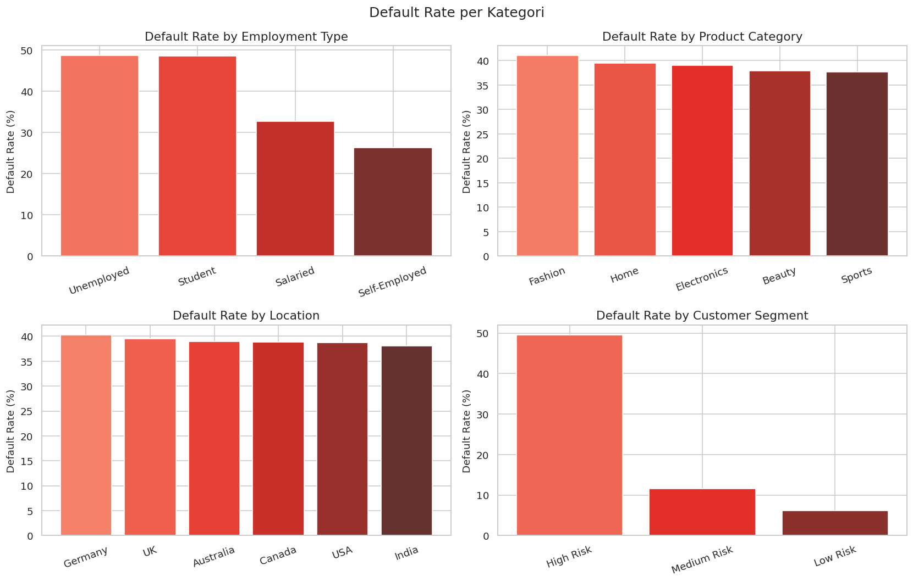
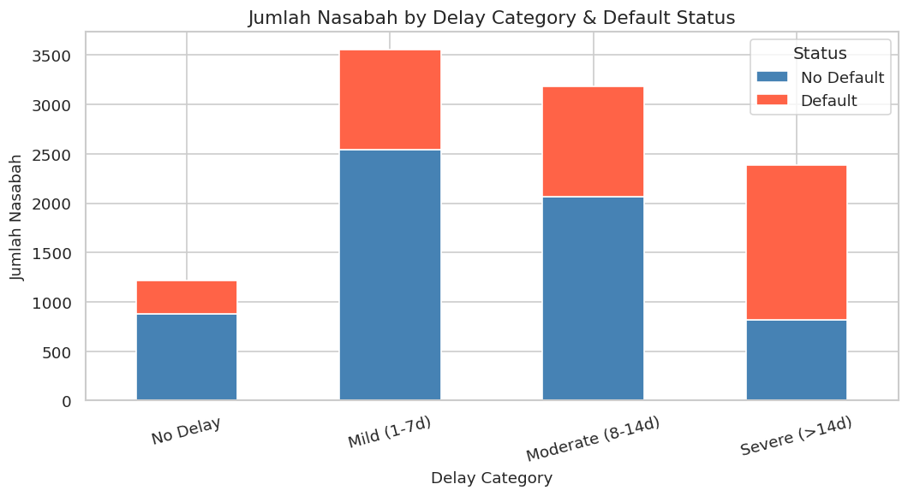
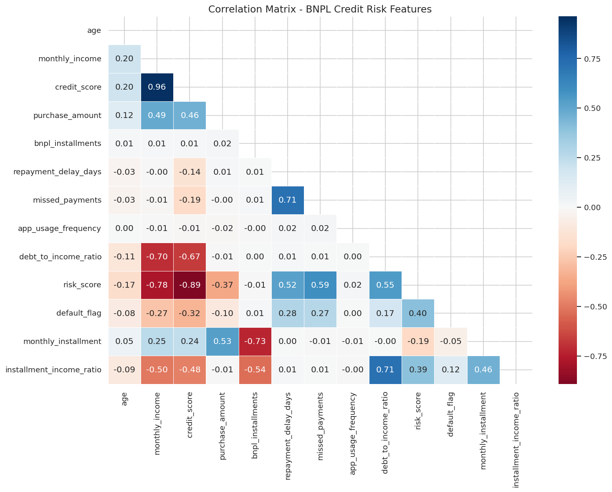
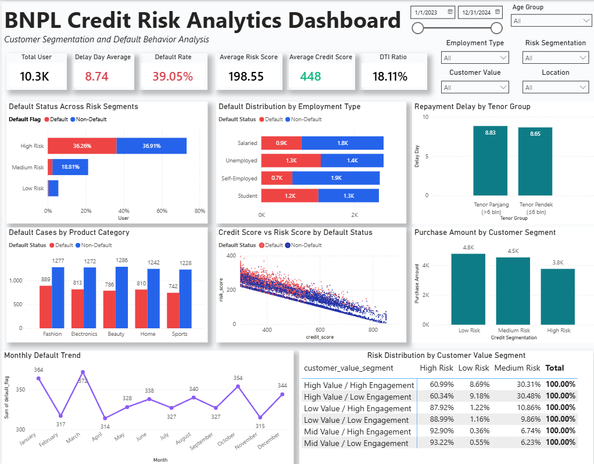

# Fintech Credit Risk Analytics for BNPL Services

Analisis end-to-end risiko kredit pada layanan *Buy Now, Pay Later* (BNPL): mengidentifikasi pelanggan berisiko tinggi, menguji faktor pendorong gagal bayar secara statistik, dan menerjemahkan temuan menjadi rekomendasi bisnis yang dapat ditindaklanjuti.

**Tools:** Python (Pandas, NumPy, SciPy, Scikit-learn, Matplotlib, Seaborn) · Power BI

---

## Ringkasan Proyek

| | |
|---|---|
| **Dataset** | [Kaggle: Buy Now, Pay Later (BNPL) Fintech ML Dataset](https://www.kaggle.com/datasets/shree0910/buy-now-and-pay-later-fintech-ml-dataset) |
| **Cakupan data** | 10.345 pelanggan, 6 negara (Jerman, Inggris, Australia, Kanada, AS, India), periode 2023–2024 |
| **Target** | `default_flag` (1 = gagal bayar, 0 = membayar tepat waktu) |
| **Tingkat gagal bayar** | **39,05%** |
| **Hasil** | 4 uji hipotesis, 6 segmen nilai pelanggan, dashboard Power BI, dan 4 rekomendasi bisnis |

## Latar Belakang dan Masalah Bisnis

Pertumbuhan BNPL berjalan lebih cepat daripada pengendalian risikonya. Tanpa cara yang andal untuk memisahkan pelanggan berisiko dari pelanggan aman, penyedia layanan menetapkan limit tanpa menimbang rasio utang terhadap pendapatan, skor kredit, dan riwayat keterlambatan secara bersamaan. Akibatnya, tingkat gagal bayar tinggi dan tidak ada indikator peringatan dini sebelum kerugian terjadi.

**Tujuan analisis:**
1. Mengidentifikasi faktor utama pendorong gagal bayar.
2. Mengelompokkan pelanggan berdasarkan profil risiko dan perilaku.
3. Merekomendasikan strategi mitigasi risiko kredit.

## Alur Analisis

`Data Understanding` → `Data Cleaning` → `Feature Engineering` → `EDA` → `Hypothesis Testing` → `Customer Segmentation` → `Kesimpulan & Rekomendasi` → `Export`

- **Data Cleaning**: konversi tipe data, validasi rentang logis, penanganan *outlier* dengan IQR capping.
- **Feature Engineering**: `installment_income_ratio`, `monthly_installment`, `delay_category`, `credit_tier`, `age_group`, `is_employed`, `ever_delayed`, komponen tanggal transaksi, dan `customer_value_segment` (nilai pembelian × tingkat engagement).
- **EDA**: distribusi, default rate per kategori, korelasi multivariat, tren bulanan, serta uji Chi-Square dan Point-Biserial.
- **Segmentasi**: segmen nilai pelanggan (3 × 2), geografis, dan demografis.

## Temuan Utama

- **Status pekerjaan adalah penentu risiko yang kuat.** Pelanggan *Unemployed* dan *Student* gagal bayar sekitar 48–49%, jauh di atas *Self-Employed* (sekitar 26%). Uji Chi-Square signifikan (χ² = 418,81, p < 0,0001).
- **Kapasitas finansial lebih menentukan daripada perilaku digital.** Rata-rata credit score pelanggan gagal bayar 392,9 berbanding 483,6 pada yang tidak gagal bayar.
- **Lokasi dan kategori produk tidak signifikan** terhadap gagal bayar (p = 0,830 dan p = 0,168), meskipun terlihat ada selisih pada grafik.
- **Frekuensi penggunaan aplikasi tidak memprediksi gagal bayar** (r = 0,0039).
- **Keterlambatan 1–7 hari adalah kelompok terbesar** (3.557 pelanggan), sehingga menjadi jendela intervensi dini terbaik.
- **Pelanggan berisiko rendah berbelanja paling besar**: rata-rata 4.775 pada *Low Risk* berbanding 3.758 pada *High Risk*.
- `monthly_income` dan `credit_score` hampir kolinear (sekitar 0,96), sehingga pada pemodelan lanjutan sebaiknya hanya salah satunya yang dipertahankan.

### Hasil Uji Hipotesis (α = 0,05)

| # | Hipotesis | Uji | Hasil |
|---|-----------|-----|-------|
| H1 | Status pekerjaan berhubungan dengan gagal bayar | Chi-Square | χ² = 18,11, p = 0,000021 → **H0 ditolak** |
| H2 | Credit score berbeda antara yang gagal bayar dan tidak | Mann-Whitney U | p < 0,000001 → **H0 ditolak** |
| H3 | Tenor cicilan memengaruhi keterlambatan pembayaran | Mann-Whitney U | p = 0,1239 → **H0 gagal ditolak** |
| H4 | Nilai belanja berbeda antarsegmen risiko | Kruskal-Wallis | H = 990,01, p < 0,000001 → **H0 ditolak** |

## Visualisasi





### Dashboard Power BI



Dashboard memuat KPI utama (total pengguna, default rate, rata-rata risk score dan credit score), tren gagal bayar bulanan, distribusi per jenis pekerjaan dan segmen, serta filter interaktif untuk lokasi, kelompok usia, jenis pekerjaan, dan segmen pelanggan.

## Rekomendasi Bisnis

| # | Rekomendasi | Ringkasan |
|---|-------------|-----------|
| 1 | **Limit kredit dinamis per segmen risiko** | *High Risk* (73,17% pelanggan): batasi limit hingga 50% dari limit standar dan wajibkan verifikasi pendapatan. *Medium Risk* (21,27%): limit standar dengan pemantauan berkala. *Low Risk* (5,57%): layak mendapat kenaikan limit dan program loyalitas. |
| 2 | **Peringatan dini berbasis hari keterlambatan** | Pengingat otomatis pada hari ke-3, pemberitahuan dampak credit score pada hari ke-7, dan peringatan keras pada hari ke-14. |
| 3 | **Perkuat onboarding *Student* dan *Unemployed*** | Wajibkan bukti pendapatan alternatif dan penjamin bila pendapatan tidak memenuhi ambang minimum. |
| 4 | **Re-engagement dan alokasi promosi** | Alihkan promosi *High Risk* ke literasi keuangan dan pengingat pembayaran; arahkan *cashback* ke pelanggan *Low/Medium Risk* yang nilai belanjanya lebih tinggi. |

## Keterbatasan dan Langkah Lanjutan

- Analisis bersifat asosiatif dan tidak menunjukkan hubungan sebab-akibat.
- Fitur `total_debt_estimate` memiliki sebaran yang hampir identik dengan `purchase_amount`, sehingga tidak ditafsirkan sebagai eksposur utang yang independen.
- Proporsi *High Risk* yang besar (73,17%) menunjukkan bahwa ambang segmentasi bawaan dataset perlu dikalibrasi ulang sebelum dipakai untuk kebijakan limit.
- **Langkah lanjutan:** membangun model prediktif skor risiko per pelanggan (misalnya Logistic Regression atau Gradient Boosting) dengan evaluasi AUC dan Precision-Recall.

## Struktur Repository

```
bnpl-credit-risk-analytics/
├── README.md
├── requirements.txt
├── .gitignore
├── data/
│   └── README.md                  # tautan dan instruksi unduh dataset
├── notebooks/
│   └── BNPL_Analysis.ipynb        # analisis lengkap (Python)
├── presentation/
│   └── BNPL_Portofolio.pdf        # deck presentasi
└── images/                        # grafik untuk README
```

## Cara Menjalankan

1. Klon repository:
   ```bash
   git clone https://github.com/rizkimughni/bnpl-credit-risk-analytics
   cd bnpl-credit-risk-analytics
   ```
2. Pasang dependensi:
   ```bash
   pip install -r requirements.txt
   ```
3. Unduh dataset dari Kaggle (lihat `data/README.md`) dan letakkan di folder `data/`.
4. Jalankan notebook:
   ```bash
   jupyter notebook notebooks/BNPL_Analysis.ipynb
   ```

## Kontak

** Mochamad Rizki Abdul Mughni **
LinkedIn: [id.linkedin.com/in/mrizkiam](https://id.linkedin.com/in/mrizkiam)
